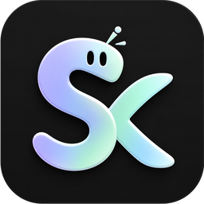
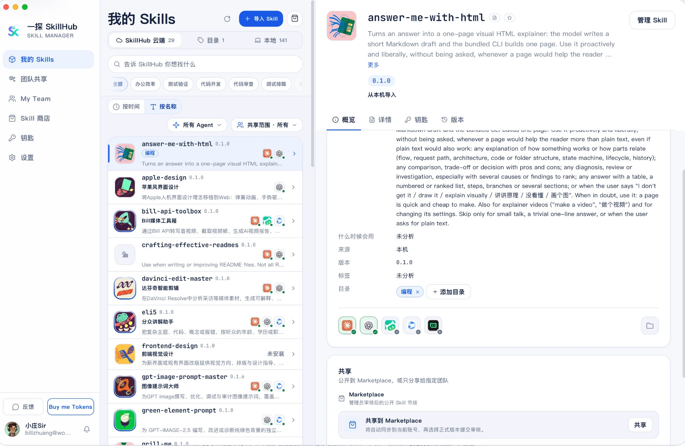

<p align="center">
  
</p>

<h1 align="center">一探 SkillHub</h1>

<p align="center">
  <strong>所有 Agent 的 Skill，在一个地方管好。</strong><br>
  装一次，Claude Code、Codex、Gemini CLI 等同时生效；还能一键共享给整个团队。
</p>

<p align="center">
  <a href="https://sk.woe.show/#download">下载 APP</a> ·
  <a href="https://sk.woe.show/docs/">使用文档</a> ·
  <a href="https://sk.woe.show/marketplace/">技能商店</a> ·
  <a href="https://sk.woe.show/#changelog">更新日志</a>
</p>

<p align="center">
  <a href="LICENSE"></a>
  
</p>

<p align="center">
  
</p>

---

## 为什么需要它

Agent 用得越多，Skill 就散得越开：同一个 Skill 在好几个文件夹里各放一份，不知道哪份是最新的；换台电脑要重新拷一遍；同事想用，还得把 API Key 一个个发过去。

SkillHub 把它们收进一个地方：帮你管版本、装到每个 Agent、跟着账号在电脑之间同步，再安全地分享给团队。

## 它能帮你做什么

- **一份 Skill，所有 Agent 同时生效**：导入一次，选好要装到哪些 Agent，不用再在各个文件夹之间来回复制。
- **改坏了，一键回退**：每次保存都留一个版本，升级、卸载前自动备份，随时回到之前的样子。
- **钥匙填一次，全部共用**：个人的 API Key 等「钥匙」只保存在本机，运行 Skill 时才注入，不会跟着 Skill 包一起分享出去。
- **Mac、Windows 自动同步**：登录同一个账号，Skill 跟着你换电脑。
- **一个人装好，整个团队都能用**：把 Skill 共享到团队，同事装上就能直接运行，团队钥匙集中管理，不用再挨个要。
- **不知道装什么？去商店挑**：精选专题和热门榜单，点「安装」就进了你的 Agent。
- **Agent 也能直接用**：APP 自带 `skillhub` 命令行，Agent 在终端里就能查询、安装和运行 Skill。

<p align="center">
  <br>
  <sub>技能商店：按专题和热门榜单找 Skill，点「安装」就装进你的 Agent</sub>
</p>

## 支持的 Agent

| Agent | macOS | Windows |
| --- | :---: | :---: |
| Claude Code | ✓ | ✓ |
| Codex / ChatGPT | ✓ | ✓ |
| Gemini CLI | ✓ | ✓ |
| OpenCode | ✓ | ✓ |
| OpenClaw | ✓ | ✓ |
| WorkBuddy | ✓ | ✓ |
| 豆包工作 | ✓ | — |
| Trae 国际版 | ✓ | — |

SkillHub 不会替你安装 Agent。先装好要用的 Agent，再在 APP「设置」里重新检测即可。每个 Agent 的检测方式和 Skill 目录见 [Agent 能力列表](https://sk.woe.show/docs/reference/agent-capabilities/)。

## 三种用法，选一种开始

|  | 一探官方 | 仅本机 | 自部署 |
| --- | --- | --- | --- |
| 适合谁 | 想马上开始 | 只整理这台电脑 | 想自己管账号和数据 |
| 导入、版本、装到 Agent | ✓ | ✓ | ✓ |
| 跨设备同步、团队共享 | 登录一探账号后可用 | — | 登录自己的实例后可用 |
| 同步数据放在哪 | 官方服务器 | 只在本机 | 你自己的服务器 |
| 服务器维护与备份 | 官方负责 | 不需要 | 你自己负责 |

新安装默认使用一探官方。只在本机管理 Skill 不需要注册登录；以后想换用法，在「设置 → 服务与账号」里切换，原来的数据会保留。技能商店和 APP 更新由官方提供，三种用法都能使用。

## 下载安装

1. 打开 [官网下载区](https://sk.woe.show/#download)，按电脑选择：**macOS**（Apple Silicon / Intel）或 **Windows**（x64 / ARM64）。
2. 安装后打开 APP，在「我的 Skills」里导入已有的 Skill，选择要装到哪些 Agent。
3. 有新版本时，APP 会自动提示升级。

> Mac 第一次打开提示「已损坏」？先确认下载的是对应芯片的版本，再按下载页给出的方法处理。

## 自己部署 Server

想让账号和同步数据都留在自己手里？一条命令就能把 SkillHub Server 跑起来。

**准备**：已启动的 Docker（Mac 可用 Docker Desktop、OrbStack 或 colima）、支持 `up --wait-timeout` 的 Docker Compose v2 或更高版本，以及 OpenSSL。

```sh
git clone https://github.com/billzhuang6569/zsir-skillhub
cd zsir-skillhub
bash deploy/selfhost/install.sh
```

向导会问 `Where to deploy? local / public / proxy:`，按你的情况选：

| 输入 | 适合 | 需要准备 |
| --- | --- | --- |
| `local` | 在这台 Mac 上自己用（APP 和 Server 在同一台电脑） | 不需要域名 |
| `public` | 云服务器，自动申请 HTTPS 证书 | 域名和证书邮箱 |
| `proxy` | 已经有自己的 HTTPS 网关 | 网关对外的 HTTPS 地址 |

首次安装大约需要 1.5–5 分钟。完成后，向导会给出 **APP 地址** 和一次性的 **初始化码**。在 APP 里打开「设置 → 服务与账号 → 自部署服务器」，填入地址，点「测试连接」→「连接到这台服务器」，再用初始化码创建管理员，就可以开始用了。

想固定在某个版本，clone 后 `git checkout` 到 [Releases](https://github.com/billzhuang6569/zsir-skillhub/releases) 里的发布标签。正式存放重要内容前，建议先读一遍 [备份、恢复与升级](https://sk.woe.show/docs/self-host/backup-restore-upgrade/)。更多部署方式见 [自部署文档](https://sk.woe.show/docs/self-host/local-deployment/)。

## 给 Agent 用的命令行

APP 自带 `skillhub` 命令，和 APP 共用同一个账号与空间，不需要单独登录：

```sh
skillhub status --json                      # 当前空间和账号
skillhub agent list --json                  # 检测到了哪些 Agent
skillhub run <skill-id> -- <程序> [参数…]    # 运行 Skill，钥匙只注入这一个进程
```

完整命令见 [CLI 与 skillhub run](https://sk.woe.show/docs/guides/cli-run/)。

## 仓库里有什么

| 目录 | 内容 |
| --- | --- |
| `desktop/` | 桌面 APP（Tauri 2、React、TypeScript）与 Rust 核心；图形界面和 `skillhub` 命令行是同一个程序 |
| `server/` | 账号、同步、团队与商店接口（Node.js、Fastify、Prisma、PostgreSQL） |
| `deploy/selfhost/` | 自部署用的 Docker Compose 与安装向导 |
| `docs/guide/` | 使用文档源文件，[在线阅读](https://sk.woe.show/docs/) |
| `qa-skills/` | 导入、安装、钥匙注入等场景的验收示例 Skill |
| `scripts/` | 文档检查、版本与签名校验等工具脚本 |

官网和捐款服务是独立运营的服务，不在本仓库中。

## 参与开发

欢迎提 Issue 和 PR。开发需要 Node 22、Rust stable 与 Tauri 2 工具链，Server 还需要 PostgreSQL。`desktop/` 和 `server/` 是各自独立的 npm 项目，下面的命令都从仓库根目录开始：

```sh
# 桌面 APP：先把 skillhub.build.example.json 复制为 skillhub.build.json
cd desktop && npm ci && npm run tauri:dev

# Server：先把 .env.example 复制为 .env 并配置数据库
cd server && npm ci && npx prisma generate && npm run dev
```

提交需要附带 DCO 签名（`git commit -s`）。分支命名、测试要求和 Review 流程见 [贡献指南](CONTRIBUTING.md)。发现安全问题请按 [安全报告](SECURITY.md) 私下提交，不要开公开 Issue。

## 支持这个项目

SkillHub 免费使用。如果它帮到了你，欢迎给仓库点个 Star，或在 APP 左下角点「Buy me Tokens」打开 [捐款页](https://bill-api.whatonearth.work/skillhub/donate/) 支持开发者。捐款是自愿支持，不购买 AI 或 fal 额度，也不解锁任何功能。

## 许可证

- Desktop、CLI 与 Server 以 [AGPL-3.0](LICENSE) 开源。
- 随 APP 提供给各个 Agent 的管理 Skill（`desktop/src-tauri/system-skills/`）使用 MIT 许可证。
- 「一探」「SkillHub」名称与 Logo 不随代码授权；分发修改版前请先阅读 [商标政策](TRADEMARK.md)。
